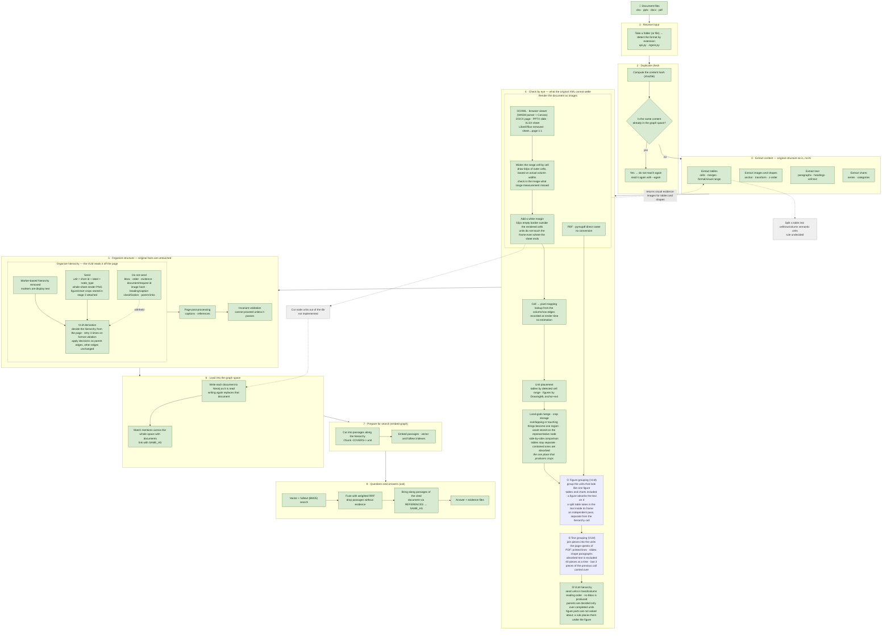

# Finalized Source Index

This file tracks the code the project has confirmed as final. Each time new code is confirmed, add one row to the tables below.

## Current pipeline

The pipeline has eight stages, from a folder of documents entering the system, to being loaded into the graph space (Neo4j), to answering questions.
Green stages are confirmed and on the production path. Gray stages are TODOs that are not yet decided.



### Source files per stage

| Stage | What it does | Source | Status |
|---|---|---|---|
| 1 · Receive input | Take a folder or file, detect the format by extension | `api.py`, `application/ingest.py` (`documents_at`, `format_of`) | Wired |
| 2 · Duplicate check | Files already in the graph space, by content hash, are not read again (they are read with `--again`) | `application/corpus_build.py`, `domain/ids.py` | Wired |
| 3 · Extract content | Tables, images, shapes, text and charts in their original structure | `adapters/extractors/{excel,pdf,powerpoint,docx,xlsx_drawings,xlsx_visual_tables}.py` | Wired |
| 4 · Check by eye | Page raster (PDF directly, OOXML by browser render). No Office/PDF conversion | `adapters/rendering/page_renderer.py`, `adapters/rendering/pdf_pages.py` | Wired |
| 4 · Range measurement CLI | Measures the actual content range of a sheet and prints JSON (no render, no conversion) | `adapters/rendering/xlsx_measurement.py`, `tools/xlsx_render/measure_ranges.py` | Confirmed |
| 4 · Unit crops (no model) | Table placement by cell→pixel lookup, figures by DrawingML extent; overlapping ones merge into one region and the crop is stored in the asset store. **This is the one crop producer** | `application/visual_crops.py`, `application/unit_regions.py`, `application/page_regions.py`, `adapters/rendering/visual_binding.py` | Wired |
| 4 · Reading stored crops | `read_node_crop()` returns the stored crop for a node id. Consumers do not recompute boxes | `application/visual_crops.py` | Wired |
| 4 · Browser renderer | Renders DOCX, PPTX and XLSX without Office, with a 1:1 sheet/slide mapping. Each render is served from its own folder on a port the system assigns, so documents rendered at the same time do not mix | `adapters/rendering/browser_office.py` | Confirmed |
| 4 · Viewer bundle | npm release (docx, pptx) + patched build (xlsx) + install script | `adapters/rendering/viewer/` | Confirmed |
| 4 · Figure grouping (VLM) | Groups the units that look like one figure: figures, tables and charts alike. One call per page, an independent pass separate from the hierarchy call. Grouped text belongs to the figure (`part_of_figure`) and drops out of later text and hierarchy passes. When a table is grouped from several pieces, same-page text inside the merged frame (separator row labels) also belongs to the table. Figures do not use this rule, because body text can stand between photographs | `adapters/vision/hierarchy_scope.py` (`group_figures`), `adapters/vision/chat_completions.py` (`group_page_figures`, `FIGURES_SYSTEM_PROMPT`) | Confirmed |
| 4 · Text grouping (VLM) | Joins the pieces the page says are one unit. Pieces are printed lines for PDF and shape paragraphs for slides. It asks 40 pieces at a time (`PIECES_PER_ASK`), and sends the last 3 pieces of the previous call (`CARRY_PIECES`, small print excluded) as already decided, so no unit is cut at a page or call boundary. Reading order is by band and column (`reading_order.py`), and small print with no body text above or below it goes to the end of the page. The page judges; the joining is arithmetic: text, box and position follow from the pieces | `application/unit_grouping.py`, `adapters/vision/text_grouping.py`, `adapters/vision/chat_completions.py` (`group_page_units`) | Confirmed |
| 4 · Browser that draws pages | Installed Chrome, otherwise Playwright's Chromium (`playwright install chromium --only-shell`) · `GRAPHME_CHROME_EXECUTABLE` | `config.py`, `adapters/rendering/browser_capture.py` | Confirmed |
| 4 · One render | Binding, figure grouping, text grouping and hierarchy do not draw the same file four times. The last drawn document is remembered by path, modification time and size | `adapters/rendering/page_renderer.py` | Confirmed |
| 5 · Hierarchy scope assembly | unit = short id + label + node_type. It reads the merges and representatives decided in stage 3 as they are (no re-merge). Placement: sheets by cell lookup, slides by shape rectangle, DOCX by rendered line position, PDF by the block rectangle the file states. Flow documents are sorted in band/column order (`in_columns`), and `indent` is measured from the left edge of the unit's own column. Figure parts are left out of the scope | `application/page_hierarchy_scope.py`, `application/unit_placement.py` | Confirmed |
| 5 · Continuous documents | A page is where the paper ran out. The document's headings are asked once on its text; every page is read side by side, shown the headings before it and the foot of the previous page; a page's reading is kept inside the page; every page break is then joined on text alone: each top unit of the page goes `under` or `beside` one of the places offered (title, sections open where the page begins, how the page before ended, what the page before was offered). Two readings per break, a third where they differ, majority wins | `adapters/vision/hierarchy_scope.py` (`derive`, `_headings`, `_read_pages`, `_join`), `application/outline_join.py` (`PageTree`, `Joining`), `adapters/vision/outline_join.py` | Confirmed |
| 5 · Page image trimming | The page sent to the model is cut at the ink boundary, leaving only a 5% margin. Crops are cut from the original page, so coordinates do not move | `adapters/vision/hierarchy_scope.py` (`_trimmed`, `TRIM_MARGIN`) | Confirmed |
| 5 · Hierarchy VLM call | Short id schema · figure/chart crops attached · decisions are parent, root, unresolved · format violations and transient model endpoint responses are retried 3 times. Figure grouping is not asked (the figure grouping pass answered first) | `adapters/vision/chat_completions.py` | Confirmed |
| 5 · Second reading | Reads one page N times in parallel, and only when the readings differ shows the page image and the two hierarchy proposals together and picks one | `adapters/vision/hierarchy_scope.py`, `adapters/vision/chat_completions.py` (`choose_hierarchy_scope`) | Confirmed |
| 5 · Figure part placement | Parts decided by figure grouping are placed under their figure without asking the VLM again. The build applies this once, together with the hierarchy decisions | `application/hierarchy_decisions.py` (`figure_part_decisions`), `application/document_graph.py` | Confirmed |
| 5 · Structure organization | Apply hierarchy decisions → captions and references → invariant validation | `application/{document_graph,hierarchy_decisions,page_enrichment}.py` | Wired |
| 6 · Graph space | Writes each document to Neo4j and links mentions across the whole space with `SAME_AS` | `application/{corpus_build,corpus_links}.py`, `adapters/storage/neo4j_space.py` | Wired |
| 7 · Search preparation | Cut into passages along the hierarchy and embed, vector and fulltext indexes (`embed-graph`) | `application/graph_chunks.py`, `adapters/storage/graph_rag.py` | Wired |
| 8 · Questions and answers | Vector + fulltext → weighted RRF → follow cited documents → answer and evidence files (`ask`) | `adapters/storage/graph_rag.py` | Wired |
| 9 · Neo4j export | The graph space as a `neo4j-admin` import bundle, `.dump`, JSON or Cypher (`export-corpus`) | `adapters/export/{neo4j,neo4j_import,neo4j_admin}.py`, `cli.py` | Wired |

## Final code list

| Area | Final source | Role | Input | Output | Status |
|---|---|---|---|---|---|
| XLSX render range measurement | `src/graphme/adapters/rendering/xlsx_measurement.py` | Measures value/formula cells, merged cells, tables and DrawingML anchors inside an XLSX and computes the actual render range of each sheet. It does not depend on the stored worksheet `dimension` or on estimating from the image by eye. | XLSX file path | `WorkbookMeasurement`; per sheet `cell_content_range`, `drawing_content_range`, `visual_content_range`, measurement evidence and warnings | Finalized |
| XLSX DrawingML parser | `src/graphme/adapters/extractors/xlsx_drawings.py` | Follows OOXML relationships to find a worksheet's drawing parts and extracts, in structured form, the `twoCellAnchor`, `oneCellAnchor`, `absoluteAnchor`, EMU offset/extent and object information of images, shapes, charts and so on. The range measurement module reuses it. | XLSX ZIP package | `DrawingManifest`, list of `DrawingObject` | Finalized dependency |
| XLSX range measurement CLI | `tools/xlsx_render/measure_ranges.py` | Runs the final measurement module on one or more XLSX files and prints per-file, per-sheet results as JSON. It does no rendering, no PDF conversion and no external provider calls. | One or more XLSX paths | JSON on standard output | Finalized |
| Browser OOXML renderer | `src/graphme/adapters/rendering/browser_office.py` | Renders DOCX, PPTX and XLSX without Office or LibreOffice. It uses a WASM parser + Canvas, and records column/row edges as it draws, so cell→pixel is a lookup with no estimation. For XLSX, sheet↔page is 1:1. | Document path + format | List of `RenderedPage` (PNG + `SheetPixelGrid`) | Finalized |
| Unit crop binding | `src/graphme/application/visual_crops.py` | Places tables by detected cell range and figures by DrawingML extent, merges what overlaps or touches into one region, and stores the crop asset on the representative node. It is **the only producer of XLSX visual node crops**, and reading is done by `read_node_crop()` in the same module. | `ExtractedDocument` + rendered pages + asset store | `ExtractedDocument` with crop asset, `crop_bbox`, `picture_count` and `CONTAINS` ownership edges attached | Finalized |
| Hierarchy scope assembly | `src/graphme/application/page_hierarchy_scope.py` (`build_sheet_scope`, `build_placed_scope`, `_indent_levels`) | Builds the unit list for one page. For merges and representative selection it **reads as is** the `CONTAINS`, `crop_bbox` and `picture_count` written by the binding stage; merging again would split the representative. In all four formats, whatever a table, pivot, figure or chart that represents a region has swallowed is treated as part of that representative and is not sent separately. A figure marked as background is not a unit. | `ExtractedDocument` + sheet name, `SheetPixelGrid` and the drawings' extents (text and tables placed by their cells, pictures and charts by their DrawingML extent), or an already placed node list, `UnitPlacer` and root node | `HierarchyScopeUnits` (unit = id · label · scope · order · node_type · indent) | Finalized |
| Hierarchy VLM call | `src/graphme/adapters/vision/chat_completions.py` (`resolve_hierarchy_scope`, `choose_hierarchy_scope`, `short_ids`, `_resolve`, `_ShortIdResult`) | Refers to units by the first 8 characters of the UUID, and sends the page render PNG together with figure/chart crops. A decision is one of three: parent, root, unresolved. The short id in the response is turned back into the full node id. If one character is missing or wrong, or only the last two characters are wrong, and exactly one unit matches, it reads that unit; if two or more match, it rejects. Format violations and transient model endpoint responses are retried up to 3 times. | `HierarchyScopeRequest` + page PNG + figure crops | `HierarchyScopeResult` (one decision per unit) | Finalized |
| Second reading | `src/graphme/adapters/vision/hierarchy_scope.py` (`RenderedHierarchyScopeProvider(readings=…)`) | Reads one page N times in parallel. If all readings are the same, it uses them as is (nothing to decide, so no cost). If they differ, it sends the page image and the two hierarchy proposals again with the same short ids and picks one whole. It does no partial merging: which reading is right is the question. | `HierarchyScopeRequest` + page PNG + crops + `readings` | One adopted reading | Finalized |
| Flow placement | `src/graphme/application/unit_placement.py` (`FlowPlacer`) | Places DOCX nodes by grouping them with the `source.path[0]` (body index) of the runs the renderer returned. A paragraph is the union of its runs, and a table is the union of its cell paragraphs. A figure is **not mixed with paragraph runs**; it is picked from the bounds given by the element hit test, by its order within the anchor paragraph. A text box is linked by its anchor paragraph and which box it is within that paragraph. | The page's flow boxes and flow drawings | `PixelBox` or None | Finalized |
| PDF page raster and vectors | `src/graphme/adapters/rendering/pdf_pages.py` (`PdfPageRenderer`, `page_ink`) | A PDF is already drawn, so no browser is needed. It rasters at 144dpi (1pt=2px) with pymupdf and returns pages in the same shape as the browser render results, together with the vector paths the page draws (borders and arrows a figure takes in). | PDF path | List of `RenderedPage`, per-page vector boxes | Finalized |
| Page supply | `src/graphme/adapters/rendering/page_renderer.py` | Routes by format to the browser or pymupdf. The crop and hierarchy passes do not need to know what drew the page. | Document path + format | List of `RenderedPage` | Finalized |
| PDF native extraction | `src/graphme/adapters/extractors/pdf.py` (`_tables_of`, `_is_layout_frame`, `_outside_tables`) | Extracts blocks, tables and figures with coordinates. A border around a report is not reported as a table and its inside is scanned again. In blocks joined by horizontal bands, it removes the lines inside tables to separate paragraphs from tables. | PDF path | `ExtractedDocument` | Finalized |
| Applying hierarchy decisions | `src/graphme/application/hierarchy_decisions.py` (`apply_hierarchy_decisions`, `note_unread_pages`, `figure_part_decisions`) | Applies decisions as `OUTLINE_PARENT` edges. A page skipped because the model could not answer is recorded as a `hierarchy_page_unread` warning. `root` removes the parent and `unresolved` is an abstention. No node leaves the graph. A decision that points to an unknown node is rejected, not silently dropped, and native ownership is not touched. Figure parts are placed under their figure by rule in `figure_part_decisions`. | `ExtractedDocument` + `HierarchyDerivation` | `ExtractedDocument` with parent edges replaced and unread pages attached as warnings | Finalized |
| Grouped figures | `src/graphme/application/figure_groups.py` (`widen_figures`) | Treats the pieces the page calls one figure as a single figure. The crop is cut again over the union of the figure's own region and the parts' regions (it never gets smaller), and parts are marked `part_of_figure` and read under the figure. For a table, same-page text inside the merged frame also becomes a part. | `ExtractedDocument` + groups the page stated + placement | `ExtractedDocument` with crops and ownership updated | Finalized |
| Page-level helpers | `src/graphme/application/page_units.py` (`flow_pages`, `held_by_a_visual`) | Several passes ask the same things: which page shows which unit (for DOCX, in one place, `flow_pages`), what other visual units already hold (`held_by_a_visual`: the `CONTAINS` or `part_of_figure` of a visual unit; this is the single absorption rule), what the stored crop is, and how to run per-page calls side by side. | `ExtractedDocument` + rendered pages | Per-page units, crops and scope names | Finalized |
| Writing captions | `src/graphme/application/visual_captions.py` (`caption_visuals`) | For each table, chart and figure, it sends the page and the stored crop and receives what it says. It does not ask about what another visual unit holds or about parts of a grouped figure (the holder answers). Six per call, together with the heading chain that unit reads under. | `ExtractedDocument` + pages + VLM | `ExtractedDocument` with `vlm_enriched_caption` nodes and `CAPTION_OF` attached | Finalized |
| Linking references | `src/graphme/application/document_references.py` (`link_references`) | Creates an `external_document` node and links it with `REFERENCES` only when the page refers to another document **explicitly**. Each answer carries a cue (`cue`) and a kind (`kind`: pointer · named · quotation · address), which go on the edge. If a document of the same name is in the store, its id is attached. | `ExtractedDocument` + pages + VLM | `ExtractedDocument` with reference nodes and edges attached | Finalized |
| Folder → graph DB | `src/graphme/application/corpus_build.py` (`build_graph`), `src/graphme/adapters/storage/neo4j_space.py` (`Neo4jGraphSpace`), CLI `graphme build-graph <folder>`, demo "Build graph" | Loads the documents in a folder into one graph DB (Neo4j) in three steps: ① process each document (a failed document is skipped and recorded) ② write all processed documents to the same space (writing again replaces that document) ③ redraw `SAME_AS` by matching the `external_document` nodes of the **whole** space with the documents in the space. Step 3 reads the space, not the folder, so documents loaded earlier are also link targets | Folder | Documents in Neo4j + `SAME_AS` | Finalized |
| Links between documents | `src/graphme/application/corpus_links.py` (`corpus_links`), `src/graphme/adapters/export/neo4j.py` (`corpus_records`, `corpus_cypher`), CLI `graphme export-corpus` | Emits all stored documents as one graph. If a document's `external_document` points to another document in the corpus, it is linked to that document's root with `SAME_AS` (`matched_by`: file_name · number · title). A document's identity is its file name, the name without extension, a document number in the file name, or a heading under which the hierarchy holds the document. It links only when exactly one document matches. It is computed over the whole corpus, so it does not depend on which document arrived first | All stored `ExtractedDocument`s | Per-document graphs + `SAME_AS` | Finalized |
| Page post-processing | `src/graphme/application/page_enrichment.py` (`RenderedPageEnricher`) | Captions and references are two questions about the same page, so it renders once and runs both one after the other. The graph build knows only this one. | Document path + `ExtractedDocument` | `ExtractedDocument` after both passes | Finalized |
| Exported edges | `src/graphme/application/final_edges.py` | Projects the internal `CONTAINS` and `OUTLINE_PARENT` into a single `PARENT_OF` (`decided_by` says what decided it; `file_parent_id` is the side the file holds). A caption is not put in the hierarchy and goes out only as `CAPTION_OF`. | `ExtractedDocument` | Edges with only four kinds left | Finalized |
| Neo4j export | `src/graphme/adapters/export/neo4j.py` (`graph_records`, `to_cypher`) | Each node gets the common label `DocNode` and a type label; edge types are the relation types as they are. Properties are scalars or same-type arrays only (mixed numbers become floats; other mixes and nesting become JSON strings), and null is omitted. Scripts are all MERGE. | `ExtractedDocument` | Neo4j record dicts, Cypher string | Finalized |
| Reading order | `src/graphme/application/reading_order.py` (`reading_order`, `in_columns`) | It cuts bands at things that span the page (60% of the width or more), groups things that overlap in x into one column within a band, and reads each column to its end. Text grouping and the hierarchy scope use the same order. `in_columns` also returns the left edge of the column each unit is read in | Items and boxes of one page | Reading order list | Finalized |
| Text grouping | `src/graphme/application/unit_grouping.py` (`group_document_units`, `explode_text`, `apply_groups`), `src/graphme/adapters/vision/text_grouping.py` (`RenderedUnitGrouper`) | Breaks text into printed pieces and asks the page for one unit to join them. It asks `PIECES_PER_ASK` at a time and carries the last `CARRY_PIECES` of the previous call over as decided. Small print (smaller than the page body size, with no body text overlapping it in x above or below) goes to the end of the page. The box of a joined unit is measured only from the pieces within the first piece's page and column. The response is a list of piece ids, and only groups that overlap or cannot be resolved are dropped | `ExtractedDocument` + page PNG | `ExtractedDocument` with pieces joined | Finalized |
| Hierarchy demo | `tools/hierarchy_demo/app.py`, `index.html` | One server runs the samples in `test_dataset/demo_samples.txt` and uploaded documents through extraction, rendering, binding, figure grouping, text grouping, VLM hierarchy, captions and references, and shows the whole document as a vis-network graph. Nodes for mentioned external documents are hidden by default. Settings use the same `load_settings` as `build-graph`. | `test_dataset/` documents | Local web screen, per-document Neo4j records and Cypher | Confirmed |

## Design principles

On 2026-09-12, the rationale that had been scattered across the decision log and research notes was moved here. The originals are in the `docs-archive-2026-09-12` commit: `git show <hash>:docs/decisions.md`. The history is in
[`docs/method.md`](docs/method.md).

### What this system does

It is not a system that redraws Office/PDF documents. It is a system that **extracts, without loss, the objects, coordinates, order, anchors, transforms and relationships that the original file states, and normalizes them into a common document model.** So authority lies not in a converted PDF/PNG but in the combination of the original package, a minimal native projection, spatial relations, and the hash and locator needed to recover the original.

The graph does not copy the original bytes. It stores only `content_hash`, `source_part`, `relationship_id` and `source_locator`, and original assets are found again in the asset store or the original package.

### Data authority order

```
1. native/package information of the original file
2. deterministic native normalization
3. deterministic spatial relation computation
4. optional derived preview
5. VLM interpretation result
```

1 to 3 are required; 4 and 5 are supplements. Even if rendering or the VLM fails, saving the native graph and building the search index must continue.

### What is preserved

Stable object ID · kind · owning container · source locator · original text and cell values · table, cell and merge ranges · content hash of image assets · package part and relationship ID · bbox or anchor · coordinate system and units · source order / z-order · group hierarchy · raw values of rotation, flip and crop · spatial relations between objects · extraction capability and warnings.

### What is not used for semantic judgment

Font family and size, bold/italic/underline, colors, art effects, shadow, gradient, transparency, 3D geometry, animation, transition, video playback, and complex chart semantics. Also **pixel rendering identical to Office**, **the semantic hierarchy of a converted PDF**, and **using the renderer's estimated page/bookmark as source ownership**. If needed, they are recorded only as provenance.

### XLSX is native-first

`ExcelExtractor` holds the authority over the workbook, worksheet, heading, text, table and image graph. Render and VLM observations can only **add** evidence to conservatively matched native nodes, and unmatched observations are not promoted into the graph.

The authoritative XLSX graph has **no page nodes.** A page is a product of rendering and mapping, not a semantic parent. Native containment and order are canonical, and every stored `NEXT` edge must join siblings under the same `CONTAINS` parent.

Only one kind of thing is ordered: the slides of a deck, the pages of a document. Siblings of a different kind under the same parent are not a step in that order. For example, the stub of another document that this document refers to by name (`EXTERNAL_DOCUMENT`) hangs under the root because every node must reach the document root, but it is not a slide, so the chain is complete without it.

> On 2026-08-29 it was decided to make nodes of every format by VLM bbox segmentation, but for XLSX the native-first decision of 2026-08-30 replaced this. It still applies to render-first formats.

### Hierarchy, order and time mean different things

Ownership and scope are `CONTAINS`/`PARENT_OF` and must be acyclic. Reading order, slide order and process flow are `NEXT`. A time claim needs an explicit date or period and a direction backed by evidence; adjacency or position in the document is not enough. The current enum has no time edge, so time facts stay in the evidence and metadata, and `NEXT` is stored only when the same evidence also proves the direction. A time order that is not backed up is left unresolved, not pushed into `NEXT` or `RELATED_TO`.

### fail-closed

- **Reconciliation is parser-first.** It checks endpoint existence, type compatibility, evidence and locator support, canonical identifiers, hierarchy cycles and conflicts with deterministic relations. On conflict the parser edge wins. An accepted VLM edge stays with its method, model, confidence and provenance, and a generated description does not become an original fact. No parallel VLM graph is built.
- **Logical composite rendering fails closed on multi-page worksheets.** It renders a composite only when the worksheet clearly maps to one page. Otherwise each figure stays as `source_media`, the component gets `source_fidelity=members_retained`, and one `drawing_composite_not_rendered` warning records the mapping failure. It never creates a `rendered_composite` evidence that does not exist.
- **Extraction does not judge captions.** Whether a bold line above a table is that table's title is not decided by font or distance. No extractor creates `CAPTION_OF`; what explains what is the job of the hierarchy pass, which looks at the page.
- **Live calls are explicit opt-in and abstain safely.** Only model endpoints allowed by `model_endpoint.py` and approved non-confidential input are used. If the index is not ready, the evidence does not support an answer, or a required service is missing, it does not invent an answer or quietly fall back to a fake; it fails closed or abstains explicitly.

### Offline profile

Only under `GRAPHME_PROFILE=test` does the setting accept the `hash` and `fake` embedders (used by `graphme serve --openapi`, which produces the API contract without a key, and by the tests). Tests do not call a model endpoint or an embedding provider; `httpx.MockTransport` answers instead. Offline results prove only the behavior of orchestration, persistence, readiness and trust boundaries, and **do not prove provider quality.**

### The CLI and the web app share bootstrap

Typer commands and FastAPI routes use the same runtime factory, settings, store and application services. Provider creation is lazy and happens at run time. The web demo is same-origin: FastAPI (`graphme serve`) serves `frontend/dist` at `/` and the JSON and evidence API at `/v1/*`.

### Libraries

| Format | Library | Supplement |
|---|---|---|
| DOCX | `python-docx` | Drawings and anchors missing from the high-level API are read directly from package XML |
| PPTX | `python-pptx` | — |
| XLSX | `openpyxl` | DrawingML anchors and extents are read directly with `zipfile` + `ElementTree` |
| PDF | `PyMuPDF` | — |

Common models and validation use `pydantic`, and content hashes use `hashlib`. The results of every format are normalized into `ExtractedDocument`.

**LibreOffice is not used as a parser that decides document structure or as a semantic parent.** On 2026-09-11 the dependency itself was removed and replaced by the browser WASM renderer.

Features not used: font-based semantic judgment, pagination and rendering identical to Word/Office, reproduction of style effects, SmartArt semantic interpretation, WordArt effects, chart data semantics.

## Processing rules summary

| Item | Final rule |
|---|---|
| Cell data range | Computed from the minimum and maximum row/column of real cells that have a value or formula |
| Merged cells and tables | Each merge range and the Table `ref` are added to the visual range |
| `twoCellAnchor` | Computed from the DrawingML `from`/`to` markers and offsets |
| `oneCellAnchor` | Covering range computed from the `from` marker and the anchor-level `xdr:ext` |
| Final render range | Use `visual_content_range`, the union of the ranges of cells, merged cells, tables and DrawingML |
| worksheet `dimension` | Recorded for diagnostics only; not used as evidence for the actual render range |
| External processing | Range measurement and unit crops call no network, AI/VLM, Office or PDF conversion |
| Figure measurement basis | The DrawingML extent, not the cell range. A figure does not fill the cells it is anchored to |
| Crop production and consumption | Production is in one place, `bind_page_visuals`; consumption is `read_node_crop(node, asset_store=…)`. Consumers do not cut again from the page |
| Text is text | Extraction does not judge text. In all four formats, text is `TEXT_CHUNK`, and HEADING, CAPTION, SECTION and `heading_level` are not created. Slide title placeholders, Word heading styles and PDF font sizes are recorded only as facts |
| Ownership | `CONTAINS` is only what holds natively: the sheet, slide or document, or the group or chart a figure belongs to. Units are not hung on a heading tree built from markers (retrieval falls back to ownership when there is no derived hierarchy, so if the judgment stays in ownership it becomes the retrieval context as is) |
| Land-grab | Common to all four formats. Text, figures, charts and tables contained in a table belong to that table, and what is contained in a figure or chart belongs to that figure. What overlaps or touches becomes one region (tables only when one wraps the other, text only when 25% or more of it lies inside), and the largest thing that nearly fills the region becomes its name. **Text does not become the name of a region where other kinds are mixed.** Whether text falls in a region is judged not by the region's grown rectangle but by **the frame of each table, or the figure made by joining the figure pieces**. A line with almost no thickness is absorbed only by something that encloses it like an arrow (a table frame or a figure) and does not join what it touches, and text does not own a line either |
| Table box | A table is measured by its whole frame: cell range for sheets, shape frame for slides, table bbox for PDF, and for DOCX the union of the cell text and the figures and boxes drawn in the cells. Only text is sized by where its glyphs are drawn (a row of photos with no text fell outside the table) |
| Shape numbers | Numbers overlap: the renderer numbers layout and master shapes with its own numbers, and a pasted group keeps its children's numbers. A text box is used for a shape only when at least half of it lies inside that shape's frame, and if a connector's number points to two or more shapes, only the one the connector touches is joined. A connector joins only figures and tables and does not pull text into a region: text belongs to a region only by lying inside it |
| Table rules | The grid of a PDF table is also vector paths. Vectors inside a table frame are not held by a figure (a photo in a cell grew along the rules to the whole table and owned the table) |
| Unit placement | Sheets use the column/row edge lookup recorded by the renderer, slides the rectangle the shape has, DOCX the union per body index of the runs the renderer returned, PDF the normalized bbox recorded by extraction. The only thing that differs by format is `UnitPlacer`; merging, cropping and scope are all the same on pixels |
| A paragraph and a figure are different things | The renderer reports figures and shapes under the **body index of the anchor paragraph**. If they were combined under the same key as paragraph runs, the paragraph would grow as large as the figure and swallow its neighbors. The paragraph box counts only its own text, and a figure is counted separately by where it is drawn |
| Indentation | Documents express indentation in two ways, paragraph settings and spaces before the sentence, and mix them on one page. Both are counted together and put on the unit as a rank within the page (`indent`, 0 is leftmost). It is an order, not a distance |
| Background | A figure that covers almost the whole page is the ground the page is drawn on, not an object on the page. It stays in the graph but is marked `background` and left out of the scope |
| Hierarchy pass targets | `SCOPE_FORMATS` = XLSX · PPTX · DOCX · PDF |
| Meaning of a page | Sheets and slides are units the author worked in, so one page is one tree. The pages of DOCX and PDF (`FLOW_FORMATS`) are where the paper ran out, so the whole document is one tree and the root is the document node |
| Page turn | A page is read on its own and shown the document's headings before it (loaded through `carried_outline.Placements.carried`: the open chain down to the last heading, then headings shallowest first up to half of the 1,200-token budget, each only with its parent loaded) and an image of the bottom 30% of the previous page. A parent it names on another page is not kept. The break is then joined: place 0 is the title (the first page's top that holds the most of it); the sections open where the page begins are walked up from where the page before stopped, through that page's reading and then the headings, guessing the last heading before an unplaced top only once; the page before's tops and last chain follow, and what the page before was offered. Tables, pictures and dropped units are never places; each place shows the first three things it holds and how many. `beside` takes the neighbour's parent once every break is answered; with no majority the shallower answer wins |
| Nodes across pages | If a paragraph or table is drawn on two pages, it is judged once, on the page that shows more of it |
| Border table | A table with no text that encloses everything else on the page, and that holds text or tables and not only figures and charts, is the border drawn around a report. It is treated like the background and left out of the scope. A table with no text that holds only photos is a photo table, not a border |
| PDF layout frame | If it covers 15% or more of the page, fewer than half its cells are filled, and one cell exceeds 200 characters, it is a border around a report, not a table. The frame is not reported, and **its inside is scanned again** (2pt inward, up to 3 levels): when the table finder finds an outer border, it does not look further inside |
| PDF text | All page text goes through `page_text`. A gap where the pen moved without a space character, larger than 15% of the font size (`WORD_GAP`), is a space: pymupdf does not fill this gap in CJK fonts |
| PDF tables and paragraphs | Text blocks are joined by horizontal bands, so a left-column paragraph and a right-hand table cell become one block. Remove the lines that fall inside a table from the block and build the paragraph from the rest |
| PDF vectors | Diagram borders and arrows are vector paths, so they do not become nodes. A figure holds the vectors it touches in the placement stage (chained), and so absorbs what is inside it by the usual rules. Layout vectors are told apart by size (under 10% of the page area, under 60% of the page in both width and height) |
| Reading order | Units of a flow document are sent in band/column order. Sorting only from top to bottom makes the head of the right column in a two-column page arrive before the end of the left column, so a section arrives before its heading |
| Small print | A piece smaller than the most common character size on the page, with no body text above or below it within the same width (footnotes, page numbers, captions above figures), goes to the end of the page. If there is body text both above and below, it is a note to the previous paragraph and stays in place |
| Box of a joined unit | Measured only from the pieces in the page and column where the first piece is. This keeps a paragraph that continues into the next column or page from becoming a page-width box and being read first |
| Figure parts | Parts decided by figure grouping are removed from the hierarchy scope and placed under their figure without asking the VLM |
| Split tables | If one table is parsed as several tables because of separator rows and figure grouping joins them into one table, the text inside the merged frame is also a part of that table |
| Document title | If the page shows the document title, the authors, abstract and all later sections are under the title. Only things that belong to no part (header, page number, watermark) stand beside the title at the top level |
| Hierarchy | `build-graph` and the demo always read the hierarchy from the page. The marker-based hierarchy is removed: a marker is only display text |
| Units sent to the VLM | `{id, label, node_type}` and, for formats where the render measures text position, `indent`. `id` is the first 8 characters of the UUID (lengthened only on a collision within a sheet). Reading order is kept only in the array order |
| Images sent to the VLM | One page image (margin trimmed) + figure/chart crops + for a continuing page, one image of the bottom 30% of the previous page. Tables get no crop; the label carries the header row and cell range |
| Number of readings | `GRAPHME_HIERARCHY_READINGS` (default 1, maximum 4). At 2 or more, readings run concurrently, and **if all agree there is no extra call**. One more judging call is made only when they differ |
| Judging method | Look at the page image + the two hierarchy proposals (same short ids) and **pick one whole**. No partial merge and no third hierarchy is created; if they are equal, the first reading is kept |
| Transient model endpoint responses | 408, 429, 502, 503, 504 and transport errors say nothing about the page, so they are retried up to 3 times at the same level as format violations |
| Conditions for a reference | A reference exists only in one of four cases: **pointer** (an explicit pointing such as "refer to ~", "see ~", "according to ~", "see"), **named** (called by name as a document, such as a report, drawing or standard number, file name, paper/book/report title, or bibliography entry), **quotation** (a quote with its source), **address** (URL, DOI, path). The name of a methodology, model, metric, dataset or product that appears as the subject of a sentence is not a reference even with a citation number (`Method [7]`, `(Kim, 2021)`): the number only points to the bibliography list, and the document is named in an entry of that list. What the code checks: the cue and the name are actually in the unit text, the cue is not the name itself (except addresses), it is at least two characters, if the cue is only a citation number then the unit must **start** with that number (a bibliography entry), and citation numbers are not linked in tables or text inside tables. A text unit sends the whole sentence (up to 600 characters) |
| When captions and references run | They run once each after the hierarchy is fully read: what to describe is only decided after the grouped figures are decided. Only one runner that runs the stages says it is done |
| Visual table recognition | Candidates are found by borders. A side may be broken for up to 10% of its length and still count as a border (a hand-drawn table has an empty cell), and the short sides are all required. Interior rules and the value/merge conditions are unchanged |
| Range read for a sheet | Only **the cells the file actually wrote** are scanned in reading order, not the `dimension` Excel declares (cells with only a border and no value included). A figure's coordinate axis is measured as far as the anchors reach and extended at the last size after that |
| Metafile figures | Photos inside EMF/WMF are stored as DIB, and the viewer could not decode 16-bit (RGB555), so only the figure's vectors were drawn. Both builds carry their own copy of the decoder, so there are two patches (`viewer/dist-patches/0002`, `viewer/patches/0004`) |
| Captions | For each table, chart and image, the rendered page and the stored crop are sent together to get a description. The answer becomes a `vlm_enriched_caption` node, held by the original with `CONTAINS` and connected toward the original with `CAPTION_OF`. Its evidence is `generated_caption` and it is not searched. It is written in the language of the page body, not of the text in the crop |
| Passages | Cut along the hierarchy. A group with no text, and a lone number standing directly under the document (page-number shape), do not become passage text |
| Search | Vector (ANN) and fulltext (BM25, `cjk`) are each fetched up to `max(40, 4·top_k)` and fused by weighted RRF (k=60, meaning 0.6 · words 0.4, reversed if the question has a number) |
| No relevant document | It is not judged by rank. Each passage must have evidence to stay: one of cosine ≥ `GRAPHME_RELEVANCE_FLOOR` (0.3), containing every word of the question, or containing the number the question names. If nothing remains, no answer is made |
| Kinds of VLM decision | `parent` · `root` · `unresolved` · `drop`. `root` is a flat result, not a failure, and `unresolved` is an explicit abstention. `drop` removes, together with what they own, only things that would be noise if search returned them (page numbers, repeated footers, watermarks, decoration). What was placed under a dropped unit moves up to the nearest remaining parent, and a dropped unit is not carried to the next page. Repeated elements are not filtered by rule: a rule that applies to every document removes content in some |
| Not sent to the VLM | `bbox`, `order`, `evidence_ids`, `document_id`, `request_id`, `scope`, `page_index`, `scope_root_id`, image hash. The response also does not accept `request_id`, `image_hash` or `manifest_hash` |

## How to run

Range measurement only:

```bash
PYTHONPATH=src python tools/xlsx_render/measure_ranges.py \
  test_dataset/real_sample/*.xlsx \
  test_dataset/test_xlsx/test1.xlsx
```

Load a folder into the graph space, including the VLM hierarchy:

```bash
graphme build-graph test_dataset/test_xlsx
```

A demo for checking the hierarchy by eye. Several documents are loaded on one server, and the only argument is the port:

```bash
.venv/bin/python tools/hierarchy_demo/app.py        # http://127.0.0.1:8765
```

The buttons at the top are the four test samples (XLSX · PPTX · DOCX · PDF); as soon as the server is up, they start running through extraction, rendering, binding and the VLM hierarchy. If you upload a local document with "Choose a file to upload", the same pipeline runs on that document, and the uploaded document stays as a button next to the samples. Files are stored only in the demo server's temporary folder and are told apart by content hash, so uploading the same file twice runs it once. Unsupported formats and empty files are rejected. A document that has run keeps its result while the server is up (reopen it with `?doc=<id>`).

The demo chooses the model and model endpoint with the same settings as `build-graph` (`load_settings`) and sets only the readings to 2. The viewer bundle is read from the settings default `~/.cache/graphme/ooxml-viewer`, and the browser from the installed Chrome — a copy kept in `/tmp` has had its files deleted by the system's periodic cleanup. A page the VLM could not answer shows as ⚠.

Rendering is one document at a time, and model calls, counting each reading and re-judgment, are capped at 24 at once across all documents (within the range measured against the model endpoint with no errors). Transient errors (overload 503 and so on) are sent again for a few minutes, with intervals growing from 5 seconds to 2 minutes. This is counted separately from the retry count for malformed answers. Each sheet and slide is its own scope, so they are read all at once and applied as answers arrive. For DOCX and PDF, pages are read side by side once the text is grouped, each applied to the graph as soon as it is read, with progress shown as "N/total read"; the page breaks are then joined and the joined outline replaces the per-page one. "Rebuild" opens after the first computation finishes and rereads all pages of the selected document from the start — renders and crops are reused, and hierarchy, removals and page results start fresh from the graph right after binding.

On the right is the graph of the whole document (vis-network hierarchical layout). The tree decides depth by `OUTLINE_PARENT` if present and by `CONTAINS` otherwise, and draws only that one parent line per node — a sheet owns all units, so drawing every ownership line would hang everything from the sheet regardless of the hierarchy. Each relation kind can be turned on and off. Elements owned by tables and figures are folded by default and shown as `+N` — the crop already shows them in place. Clicking a node shows, on the left, its stored crop, body and properties, and the page where the node is drawn. The graph data is the same as the Neo4j records below (`/v1/files/<id>/graph`, `/v1/files/<id>/graph.cypher`).

## Neo4j export

```bash
graphme export-corpus OUT_DIR                 # neo4j-admin import bundle (default)
graphme export-corpus out.cypher --cypher     # run in cypher-shell · Neo4j Browser (without passages)
graphme export-corpus out.json --json         # records in the shape the driver returns
```

| Graph | Neo4j |
|---|---|
| Node | Common label `DocNode` (with a unique constraint on `id`) + type label (`text_chunk` → `TextChunk`) |
| Edge | Exporting one document gives only four kinds (`PARENT_OF`, `NEXT`, `CAPTION_OF`, `REFERENCES`); exporting a corpus adds `SAME_AS` between documents. It MERGEs on the `id` property, and the corpus script writes relationships after writing all nodes |
| Properties | Scalars and scalar arrays only. Nested values are JSON strings and null is omitted (setting it would delete the key). Node metadata is `meta_<key>`, and the locator is spread into `page` · `sheet` · `slide` · `cell_range` · `bbox` |

The scripts are all MERGE, so running them twice gives the same result. Putting several documents in one DB does not make ids collide.

## How to verify

Measurement and reading results are values taken from confidential documents, so they are not written here. Only the way to check is kept.

### Render range measurement

Run `measure_ranges.py` on the target file to get `visual_content_range` per sheet. The same file must give the same range on every run — it is computed as the union of value/formula cells, merges, the Table `ref` and DrawingML anchors, not from the stored worksheet `dimension` or an estimate by eye. If it differs, the measurement logic was touched.

### Hierarchy pass

Run both a worksheet document and a slide document with `build-graph` or the demo, and check the following.

- Every page must **pass in one call with 0 retries**. If retries occur, the response format or the id length was touched.
- Exactly one decision must come out per unit. If one is missing, `validate_for` rejects it.
- The number of `parent` decisions and the number of generated `OUTLINE_PARENT` edges must be equal.
  Nothing may be cut off. The demo shows, page by page, what was dropped.
- With `GRAPHME_HIERARCHY_READINGS` set to 2, one line per page is left in the log, either "N readings agree" or "readings differ, #k adopted — reason". If the reason does not point to the placement and is a generality, the judging prompt was touched.
- A person checks whether the hierarchy matches the placement on the rendered page. It must be the result of reading the placement, not of the cell range strings. For slides, also check that the range a figure swallowed matches the actual figure area.

### Crop agreement

For the same node, the crop the hierarchy pass attached and the bytes `read_node_crop()` returns must be the same down to the sha256. If they differ, some consumer is recomputing the box.

### Payload check

When you change a payload, intercept the HTTP body the adapter actually sends with `httpx.MockTransport` and check it. Looking at a copy built by duplicating the prompt will not catch a drift from the adapter.

### Automated checks

The test suite is not in the repository — `/tests/` is a local experiment space. `ruff check .` and `mypy src` run on the repository alone.
