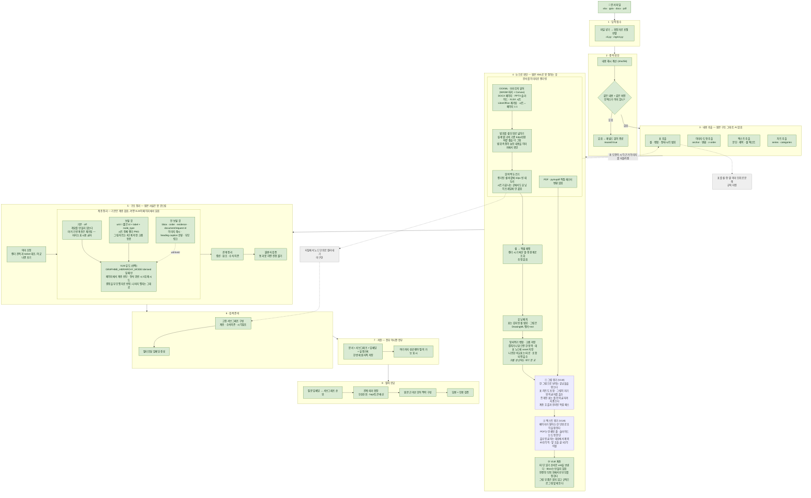

# Finalized Source Index

프로젝트에서 최종 버전으로 확정된 코드를 누적 관리한다. 새 코드가 확정될 때마다 아래 표에 한 행씩 추가한다.

## 현재 파이프라인

문서 파일 하나가 들어와서 인덱스가 되고 질의에 답하기까지를 8단계로 묶은 것이다.
초록색은 확정되어 production 경로에 있는 단계, 회색은 아직 정하지 않은 TODO다.



### 단계별 근거 파일

| 단계 | 하는 일 | 소스 | 상태 |
|---|---|---|---|
| 1 · 입력 접수 | 파일 받기, 확장자로 포맷 판별 | `cli.py`, `application/ingest.py` | 연결됨 |
| 2 · 중복 확인 | 내용 해시, extractor/pipeline 버전 인지 재사용 | `application/ingest.py`, `domain/ids.py` | 연결됨 |
| 3 · 내용 추출 | 표·이미지·도형·텍스트·차트를 원본 구조 그대로 | `adapters/extractors/{excel,pdf,powerpoint,docx,xlsx_drawings,xlsx_visual_tables}.py` | 연결됨 |
| 4 · 눈으로 확인 | 페이지 래스터(PDF는 직접, OOXML은 브라우저 렌더), 이어서 VLM 시각 관측. Office/PDF 변환 없음 | `application/grounding.py`, `adapters/rendering/page_image.py` | 연결됨 |
| 4 · 범위 측정 CLI | 시트 실제 내용 범위를 측정해 JSON으로 내놓는다(렌더·변환 없음) | `application/xlsx_measurement.py`, `tools/xlsx_render/measure_ranges.py` | 확정 |
| 4 · 유닛 크롭 (모델 없음) | 셀→픽셀 조회로 표 배치·그림은 DrawingML extent, 겹치면 한 영역으로 병합해 크롭을 asset에 저장. **크롭 생산자는 이 한 곳** | `application/xlsx_visual_binding.py`, `application/xlsx_unit_regions.py`, `application/xlsx_crop_regions.py`, `adapters/rendering/visual_binding.py` | 연결됨 |
| 4 · 저장된 크롭 읽기 | `read_node_crop()` — 노드 id로 저장된 크롭을 돌려준다. 소비자가 박스를 다시 계산하지 않는다 | `application/xlsx_visual_binding.py` | 연결됨 |
| 4 · 브라우저 렌더러 | DOCX·PPTX·XLSX를 Office 없이 렌더, 시트·슬라이드 1:1 매핑. 렌더마다 자기 폴더와 시스템이 준 포트로 서빙해 여러 문서를 동시에 렌더해도 섞이지 않는다 | `adapters/rendering/browser_office.py` | 확정 |
| 4 · 뷰어 번들 | npm 배포본(docx·pptx) + 패치 빌드(xlsx) + 설치 스크립트 | `adapters/rendering/viewer/` | 확정 |
| 4 · 그림 묶기 (VLM) | 한 그림으로 보이는 유닛을 묶는다 — 그림·표·차트 모두. 페이지마다 한 번, 계층 호출과 분리된 독립 패스다. 묶인 글자는 그림의 것(`part_of_figure`)이 되어 이후 텍스트·계층에서 빠진다. 표가 여러 조각으로 묶이면 합친 틀 안에 든 같은 페이지의 텍스트(구분 행 라벨)도 표의 것이다 — 그림은 사진 사이에 본문이 끼일 수 있어 이 규칙을 쓰지 않는다 | `adapters/vision/hierarchy_scope.py` (`group_figures`), `adapters/vision/chat_completions.py` (`group_page_figures`, `FIGURES_SYSTEM_PROMPT`) | 확정 |
| 4 · 텍스트 묶기 (VLM) | 페이지가 한 단위라고 말하는 조각들을 합친다. 조각은 PDF는 인쇄된 줄, 슬라이드는 도형의 문단. 한 번에 40조각(`PIECES_PER_ASK`)씩 묻고, 앞 호출의 끝 3조각(`CARRY_PIECES`, 작은 글씨 제외)을 결정된 채로 함께 보내 페이지·호출 경계에서 끊기지 않게 한다. 읽기 순서는 띠·단 단위(`reading_order.py`)이고, 작은 글씨 중 위나 아래에 본문이 없는 것은 페이지 끝으로 보낸다. 판단은 페이지가, 합치기는 산수로 — 텍스트·박스·자리는 조각에서 따라 나온다 | `application/unit_grouping.py`, `adapters/vision/text_grouping.py`, `adapters/vision/chat_completions.py` (`group_page_units`) | 확정 |
| 4 · 묶기 모드 전환 | 기본 `off`(파일이 인쇄한 대로) · `GRAPHME_UNIT_GROUPING=page`로 켠다. `GRAPHME_HIERARCHY_MODE=derived`와 함께여야 동작 — 양방향 fail-closed | `config.py`, `runtime.py`, `application/indexing.py` | 확정 |
| 4 · 페이지를 그리는 브라우저 | 설치된 Chrome, 없으면 Playwright의 Chromium(`playwright install chromium --only-shell`) · `GRAPHME_CHROME_EXECUTABLE` | `config.py`, `adapters/rendering/browser_capture.py` | 확정 |
| 4 · 렌더 한 번 | 결속·그림 묶기·텍스트 묶기·계층이 같은 파일을 네 번 그리지 않는다. 마지막으로 그린 문서를 경로·수정시각·크기로 기억한다 | `adapters/rendering/page_renderer.py` | 확정 |
| 5 · 계층 스코프 조립 | unit = 짧은 id + label + node_type. 3단계가 정한 병합·대표를 그대로 읽는다(재병합 없음). 시트는 셀 조회, 슬라이드는 도형 사각형, DOCX는 렌더된 줄 위치, PDF는 파일이 말하는 블록 사각형으로 배치. 흐름 문서는 띠·단 순서(`in_columns`)로 정렬하고 `indent`는 자기 단의 왼쪽 끝에서 잰다. 그림 부품은 스코프에서 뺀다 | `application/page_hierarchy_scope.py`, `application/unit_placement.py` | 확정 |
| 5 · 연속 문서 | 페이지는 종이가 끝난 자리다. 페이지 순서대로 읽고, 각 페이지는 앞 페이지들이 만든 계층(예산 1,200 토큰: 열린 사슬 → 제목 골격 → 최근 절 통째로)과 그 페이지의 끝부분 이미지를 함께 받는다 | `adapters/vision/hierarchy_scope.py` (`FLOW_FORMATS`, `_Placements.carried`, `_open_chain`, `_page_tail`) | 확정 |
| 5 · 페이지 이미지 정리 | 모델에게 보내는 페이지는 잉크 경계로 잘라 여백 5%만 남긴다. 크롭은 원본 페이지에서 잘리므로 좌표는 움직이지 않는다 | `adapters/vision/hierarchy_scope.py` (`_trimmed`, `TRIM_MARGIN`) | 확정 |
| 5 · 계층 모드 전환 | 기본 `off`(개요 없음) · `GRAPHME_HIERARCHY_MODE=derived`로 VLM 유도. 양방향 fail-closed | `application/indexing.py`, `application/hierarchy_decisions.py`, `adapters/vision/hierarchy_scope.py` | 확정 |
| 5 · 계층 VLM 호출 | 짧은 id 스키마 · 그림·차트 크롭 동봉 · 결정은 parent·root·unresolved · 형식 위반과 일시적 모델 endpoint 응답은 3회 재시도. 그림 묶음은 묻지 않는다(그림 묶기 패스가 먼저 답했다) | `adapters/vision/chat_completions.py` | 확정 |
| 5 · 두 번째 판독 | 한 페이지를 N회 병렬 판독하고, 갈릴 때만 페이지 이미지와 두 계층안을 함께 보여 하나를 고른다 | `adapters/vision/hierarchy_scope.py`, `adapters/vision/chat_completions.py` (`choose_hierarchy_scope`) | 확정 |
| 5 · 그림 부품 배치 | 그림 묶기가 정한 부품을 VLM에 다시 묻지 않고 그 그림 밑에 둔다. 빌드가 계층 결정과 함께 한 번 반영한다 | `application/hierarchy_decisions.py` (`figure_part_decisions`), `application/indexing.py` | 확정 |
| 5 · 구조 정리 | 의미 조정 → 계층 결정 반영 → 관계 → 불변식 검증 | `application/{semantic_reconciliation,hierarchy_decisions,relations}.py` | 연결됨 |
| 6 · 검색 준비 | 고정 서브그래프 + 멀티모달 임베딩 | `application/{index_representation,subgraphs,embedding}.py` | 연결됨 |
| 7 · 저장 | 원자적 인덱스 저장, ready 표시 | `adapters/storage/graph.py` | 연결됨 |
| 8 · 질의·응답 | 순위 → 확장 → 근거 조립 → 답변·인용 | `application/{query,retrieve,answer_generation}.py` | 연결됨 |
| 9 · Neo4j 내보내기 | 저장된 그래프를 Neo4j 레코드·Cypher 스크립트로 (`export-neo4j`) | `adapters/export/neo4j.py`, `cli.py` | 연결됨 · 실DB 적재 미검증 |

## 최종 코드 목록

| 구분 | 최종 소스 | 역할 | 입력 | 출력 | 상태 |
|---|---|---|---|---|---|
| XLSX 렌더링 범위 측정 | `src/graphme/application/xlsx_measurement.py` | XLSX 내부의 값/수식 셀, 병합 셀, 표 및 DrawingML anchor를 측정하고 시트별 실제 렌더링 범위를 계산한다. 저장된 worksheet `dimension`이나 이미지 육안 추정에 의존하지 않는다. | XLSX 파일 경로 | `WorkbookMeasurement`; 시트별 `cell_content_range`, `drawing_content_range`, `visual_content_range`, 측정 근거 및 경고 | Finalized |
| XLSX DrawingML 파서 | `src/graphme/adapters/extractors/xlsx_drawings.py` | OOXML relationship을 따라 worksheet의 drawing part를 찾고 이미지·도형·차트 등의 `twoCellAnchor`, `oneCellAnchor`, `absoluteAnchor`, EMU offset/extent와 객체 정보를 구조적으로 추출한다. 범위 측정 모듈이 재사용한다. | XLSX ZIP 패키지 | `DrawingManifest`, `DrawingObject` 목록 | Finalized dependency |
| XLSX 범위 측정 CLI | `tools/xlsx_render/measure_ranges.py` | 하나 이상의 XLSX 파일에 최종 측정 모듈을 실행하고 파일·시트별 결과를 JSON으로 출력한다. 렌더링, PDF 변환 및 외부 provider 호출은 수행하지 않는다. | XLSX 경로 1개 이상 | 표준 출력 JSON | Finalized |
| 브라우저 OOXML 렌더러 | `src/graphme/adapters/rendering/browser_office.py` | DOCX·PPTX·XLSX를 Office나 LibreOffice 없이 렌더한다. WASM 파서 + Canvas이고, 열·행 경계를 함께 기록해 셀→픽셀을 추정 없이 조회한다. XLSX는 시트↔페이지 1:1. | 문서 경로 + 포맷 | `RenderedPage` 목록 (PNG + `SheetPixelGrid`) | Finalized |
| 유닛 크롭 바인딩 | `src/graphme/application/xlsx_visual_binding.py` | 표는 감지된 셀 범위, 그림은 DrawingML extent로 배치하고 겹치거나 닿는 것을 한 영역으로 병합해 대표 노드에 크롭 asset을 저장한다. **XLSX 시각 노드 크롭의 유일한 생산자**이며 읽기는 같은 모듈의 `read_node_crop()`이 맡는다. | `ExtractedDocument` + 렌더 페이지 + asset store | 크롭 asset·`crop_bbox`·`picture_count`·`CONTAINS` 소유 엣지가 붙은 `ExtractedDocument` | Finalized |
| 계층 스코프 조립 | `src/graphme/application/page_hierarchy_scope.py` (`build_sheet_scope`, `build_placed_scope`, `_indent_levels`) | 한 페이지의 unit 목록을 만든다. 병합과 대표 선정은 바인딩 단계가 적어 둔 `CONTAINS`·`crop_bbox`·`picture_count`를 **그대로 읽는다** — 재병합하면 대표가 갈린다. 영역을 대표하는 표·피벗·그림·차트가 삼킨 것은 네 포맷 모두 그 대표의 일부로 보고 따로 보내지 않는다. 배경으로 표시된 그림은 unit이 아니다. | `ExtractedDocument` + 시트명·`SheetPixelGrid`, 또는 이미 배치된 노드 목록·`UnitPlacer`·루트 노드 | `HierarchyScopeUnits` (unit = id·label·scope·order·node_type·indent) | Finalized |
| 계층 VLM 호출 | `src/graphme/adapters/vision/chat_completions.py` (`resolve_hierarchy_scope`, `choose_hierarchy_scope`, `short_unit_ids`, `_resolve`, `_ShortIdResult`) | unit을 UUID 앞 8자로 부르고, 페이지 렌더 PNG와 그림·차트 크롭을 함께 보낸다. 결정은 parent·root·unresolved 셋이다. 응답의 짧은 id를 완전한 node id로 되돌린다 — 한 글자가 빠지거나 틀려도, 또는 끝 두 글자만 틀려도 유일하게 대응되는 unit이 있으면 그 unit으로 읽고, 둘 이상에 걸리면 거절한다. 형식 위반과 일시적 모델 endpoint 응답은 3회까지 재시도한다. | `HierarchyScopeRequest` + 페이지 PNG + 그림 크롭 | `HierarchyScopeResult` (unit마다 결정 1개) | Finalized |
| 두 번째 판독 | `src/graphme/adapters/vision/hierarchy_scope.py` (`RenderedHierarchyScopeProvider(readings=…)`) | 한 페이지를 N회 병렬로 판독한다. 판독이 전부 같으면 그대로 쓰고(정할 것이 없으면 비용도 없다), 갈리면 페이지 이미지와 두 계층안을 같은 짧은 id로 다시 보내 하나를 통째로 고른다. 부분 병합은 하지 않는다 — 어느 판독이 맞는지가 질문이다. | `HierarchyScopeRequest` + 페이지 PNG + 크롭 + `readings` | 채택된 판독 하나 | Finalized |
| 흐름 배치 | `src/graphme/application/unit_placement.py` (`FlowPlacer`) | DOCX 노드를 렌더러가 돌려준 run의 `source.path[0]`(본문 인덱스)로 묶어 배치한다. 문단은 자기 run들의 합집합, 표는 셀 문단들의 합집합. 그림은 **문단 run과 섞지 않고** 요소 히트테스트가 준 bounds에서 앵커 문단 안의 순서로 집는다. 텍스트박스는 앵커 문단과 그 문단에서 몇 번째 상자인지로 잇는다. | 페이지의 flow box와 flow drawing | `PixelBox` 또는 None | Finalized |
| PDF 페이지 래스터·벡터 | `src/graphme/adapters/rendering/pdf_pages.py` (`PdfPageRenderer`, `page_ink`) | PDF는 이미 그려져 있으므로 브라우저가 필요 없다. pymupdf로 144dpi(1pt=2px) 래스터해 브라우저 렌더 결과와 같은 모양의 페이지를 돌려주고, 페이지가 그린 벡터 path도 함께 준다(그림이 품을 테두리·화살표). | PDF 경로 | `RenderedPage` 목록, 페이지별 벡터 박스 | Finalized |
| 페이지 공급 | `src/graphme/adapters/rendering/page_renderer.py` | 포맷에 따라 브라우저와 pymupdf로 갈라 준다. 크롭·계층 패스는 무엇이 그렸는지 알 필요가 없다. | 문서 경로 + 포맷 | `RenderedPage` 목록 | Finalized |
| PDF 네이티브 추출 | `src/graphme/adapters/extractors/pdf.py` (`_tables_of`, `_is_layout_frame`, `_outside_tables`) | 블록·표·그림을 좌표와 함께 뽑는다. 보고서를 두른 테두리는 표로 보고하지 않고 그 안쪽을 다시 훑으며, 가로 띠로 묶인 블록에서 표 안의 줄을 빼 문단과 표를 가른다. | PDF 경로 | `ExtractedDocument` | Finalized |
| 계층 결정 반영 | `src/graphme/application/hierarchy_decisions.py` (`apply_hierarchy_decisions`, `note_unread_pages`, `figure_part_decisions`) | 결정을 `OUTLINE_PARENT` 엣지로 반영한다. 모델이 답하지 못해 건너뛴 페이지는 `hierarchy_page_unread` 경고로 남긴다. `root`는 부모를 지우고 `unresolved`는 기권이다. 그래프에서 빠지는 노드는 없다. 모르는 노드를 가리키는 결정은 조용히 버리지 않고 거부하며 native ownership은 건드리지 않는다. 그림 부품은 `figure_part_decisions`가 규칙으로 그림 밑에 둔다. | `ExtractedDocument` + `HierarchyDerivation` | 부모 엣지가 교체되고 읽지 못한 페이지가 경고로 붙은 `ExtractedDocument` | Finalized |
| 묶음 그림 | `src/graphme/application/figure_groups.py` (`widen_figures`) | 페이지가 하나의 그림이라고 말한 조각들을 한 그림으로 본다. 크롭은 그림이 이미 가진 영역과 부분들의 영역을 합쳐 다시 자르고(작아지지 않는다), 부분은 `part_of_figure`로 표시되어 그림 아래로 읽힌다. 표라면 합친 틀 안에 든 같은 페이지의 텍스트도 부분이 된다. | `ExtractedDocument` + 페이지가 말한 묶음 + 배치 | 크롭과 소유가 갱신된 `ExtractedDocument` | Finalized |
| 페이지 단위 헬퍼 | `src/graphme/application/page_units.py` (`flow_pages`, `held_by_a_visual`) | 여러 패스가 같은 것을 묻는다 — 어느 페이지가 어느 유닛을 보여주는지(DOCX는 `flow_pages` 한 곳에서), 다른 시각 유닛이 이미 품은 것은 무엇인지(`held_by_a_visual`: 시각 유닛의 `CONTAINS` 또는 `part_of_figure`, 흡수 규칙은 이 하나), 저장된 크롭은 무엇인지, 페이지별 호출을 어떻게 나란히 돌리는지. | `ExtractedDocument` + 렌더 페이지 | 페이지별 유닛·크롭·스코프 이름 | Finalized |
| 캡션 쓰기 | `src/graphme/application/visual_captions.py` (`caption_visuals`) | 표·차트·그림마다 페이지와 저장된 크롭을 보내 그것이 말하는 바를 받는다. 다른 시각 유닛이 품은 것과 묶음 그림의 부분은 묻지 않는다(품은 쪽이 답한다). 한 호출에 6개씩, 그 유닛이 읽히는 제목 사슬과 함께. | `ExtractedDocument` + 페이지 + VLM | `vlm_enriched_caption` 노드와 `CAPTION_OF`가 붙은 `ExtractedDocument` | Finalized |
| 참조 잇기 | `src/graphme/application/document_references.py` (`link_references`) | 페이지가 **명시적으로** 다른 문서를 참조할 때만 `external_document` 노드를 만들고 `REFERENCES`로 잇는다. 답마다 근거 문구(`cue`)와 종류(`kind`: pointer·named·quotation·address)를 받아 엣지에 싣는다. 같은 이름의 문서가 저장소에 있으면 그 id를 싣는다. | `ExtractedDocument` + 페이지 + VLM | 참조 노드·엣지가 붙은 `ExtractedDocument` | Finalized |
| 폴더 → 그래프 DB | `src/graphme/application/corpus_build.py` (`build_graph`), `src/graphme/adapters/storage/neo4j_space.py` (`Neo4jGraphSpace`), CLI `graphme build-graph <폴더>`, 데모 "그래프 만들기" | 폴더 안의 문서를 세 단계로 하나의 그래프 DB(Neo4j)에 올린다 — ① 문서마다 처리(실패한 문서는 건너뛰고 기록) ② 처리된 문서를 모두 같은 공간에 쓴다(다시 쓰면 그 문서를 교체) ③ 공간 **전체**의 `external_document`를 공간 안 문서와 맞춰 `SAME_AS`를 다시 그린다. 3단계가 폴더가 아니라 공간을 읽으므로 앞서 올린 문서도 연결 대상이다 | 폴더 | Neo4j 안의 문서들 + `SAME_AS` | Finalized |
| 문서 간 연결 | `src/graphme/application/corpus_links.py` (`corpus_links`), `src/graphme/adapters/export/neo4j.py` (`corpus_records`, `corpus_cypher`), CLI `graphme export-corpus` | 저장된 문서 전체를 한 그래프로 낸다. 각 문서의 `external_document`가 코퍼스 안의 다른 문서를 가리키면 `SAME_AS`로 그 문서의 루트에 잇는다(`matched_by`: file_name·number·title). 문서의 정체는 파일 이름, 확장자 뺀 이름, 파일 이름 속 문서 번호, 계층이 문서를 담은 제목이다. 정확히 한 문서만 맞을 때만 잇는다. 코퍼스 전체에서 계산하므로 어느 문서가 먼저 들어왔는지와 무관하다 | 저장된 `ExtractedDocument` 전체 | 문서별 그래프 + `SAME_AS` | Finalized |
| 페이지 후처리 | `src/graphme/application/page_enrichment.py` (`RenderedPageEnricher`) | 캡션과 참조는 같은 페이지에 대한 두 질문이므로 한 번만 렌더하고 둘을 잇달아 돌린다. 인덱싱은 이 하나만 안다. | 문서 경로 + `ExtractedDocument` | 두 패스를 거친 `ExtractedDocument` | Finalized |
| 내보내는 엣지 | `src/graphme/application/final_edges.py` | 내부의 `CONTAINS`·`OUTLINE_PARENT`를 `PARENT_OF` 하나로 투영한다(무엇이 정했는지는 `decided_by`, 파일이 품은 쪽은 `file_parent_id`). 캡션은 계층에 넣지 않고 `CAPTION_OF`로만 나간다. | `ExtractedDocument` | 네 종류만 남은 엣지 | Finalized |
| Neo4j 내보내기 | `src/graphme/adapters/export/neo4j.py` (`graph_records`, `to_cypher`) | 노드마다 공통 라벨 `DocNode`와 타입 라벨, 엣지 타입은 관계 타입 그대로. 속성은 스칼라·같은 타입 배열만(섞인 수는 실수로, 그 밖에 섞인 것과 중첩은 JSON 문자열), null은 뺀다. 스크립트는 전부 MERGE. | `ExtractedDocument` | Neo4j 레코드 dict, Cypher 문자열 | Finalized |
| 읽기 순서 | `src/graphme/application/reading_order.py` (`reading_order`, `in_columns`) | 페이지를 가로지르는 것(폭 60% 이상)에서 띠로 자르고, 띠 안에서는 x로 겹치는 것끼리 한 단으로 묶어 단마다 끝까지 읽는다. 텍스트 묶기와 계층 스코프가 같은 순서를 쓴다. `in_columns`는 각 unit이 읽히는 단의 왼쪽 끝도 돌려준다 | 한 페이지의 항목과 박스 | 읽기 순서 목록 | Finalized |
| 텍스트 묶기 | `src/graphme/application/unit_grouping.py` (`group_document_units`, `explode_text`, `apply_groups`), `src/graphme/adapters/vision/text_grouping.py` (`RenderedUnitGrouper`) | 텍스트를 인쇄된 조각으로 풀고, 페이지에 한 단위를 물어 합친다. 한 번에 `PIECES_PER_ASK`개, 앞 호출 끝 `CARRY_PIECES`개를 결정된 채로 이월한다. 작은 글씨(페이지 본문 크기보다 작고, 위나 아래에 x로 겹치는 본문이 없는 것)는 페이지 끝으로 보낸다. 합친 단위의 박스는 첫 조각의 페이지·단 안의 조각만으로 잰다. 응답은 조각 id 목록이고, 겹치거나 해석할 수 없는 그룹만 버린다 | `ExtractedDocument` + 페이지 PNG | 조각이 합쳐진 `ExtractedDocument` | Finalized |
| 계층 데모 | `tools/hierarchy_demo/app.py`, `index.html` | 서버 하나에 `test_dataset/demo_samples.txt`의 샘플과 올린 문서를 추출·렌더·바인딩·그림 묶기·텍스트 묶기·VLM 계층·캡션·참조까지 돌리고, 문서 전체를 vis-network 그래프로 보여준다. 언급된 외부 문서 노드는 기본으로 숨긴다. 설정은 ingest와 같은 `load_settings`. | `test_dataset/` 문서 | 로컬 웹 화면, 문서별 Neo4j 레코드·Cypher | 확정 |

## 설계 원칙

결정 로그와 연구 기록에 흩어져 있던 근거를 2026-09-12에 여기로 옮겼다. 원본은
`docs-archive-2026-09-12` 커밋에 있다 — `git show <해시>:docs/decisions.md`. 이력은
[`docs/method.md`](docs/method.md)에 있다.

### 이 시스템이 하는 일

Office/PDF 문서를 다시 그리는 시스템이 아니다. **원본 파일이 명시하는
객체·좌표·순서·anchor·transform·관계를 손실 없이 추출해 공통 문서 모델로 정규화하는
시스템**이다. 따라서 권위는 변환된 PDF/PNG가 아니라 원본 package + 최소 native
projection + 공간 관계 + 원본을 되찾을 hash·locator의 결합에 있다.

Graph에 원본 bytes를 복사하지 않는다. `content_hash`, `source_part`,
`relationship_id`, `source_locator`만 저장하고 원본 asset은 asset store나 원본
package에서 다시 찾는다.

### 데이터 권위 순서

```
1. 원본 파일의 native/package 정보
2. deterministic native normalization
3. deterministic spatial relation 계산
4. 선택적 파생 preview
5. VLM 해석 결과
```

1~3은 필수이고 4~5는 보강이다. 렌더링이나 VLM이 실패해도 native graph 저장과 검색
인덱스 생성은 계속돼야 한다.

### 보존하는 것

객체의 안정적 ID · 종류 · 소속 container · source locator · 원본 텍스트와 셀 값 ·
표·셀·병합 범위 · 이미지 asset의 content hash · package part와 relationship ID ·
bbox 또는 anchor · 좌표계와 단위 · source order / z-order · group hierarchy ·
rotation·flip·crop의 raw 값 · 객체 간 공간 관계 · extraction capability와 warning.

### 의미 판단에 쓰지 않는 것

font family·size, bold/italic/underline, 색상, art effect, shadow, gradient,
transparency, 3D geometry, animation, transition, video playback, 복잡한 chart
semantics. 또한 **Office와 동일한 pixel rendering**, **변환된 PDF의 semantic
hierarchy**, **렌더러가 추정한 page/bookmark를 source ownership으로 쓰는 것**.
필요하면 provenance로만 기록한다.

### XLSX는 native-first

`ExcelExtractor`가 workbook·worksheet·heading·text·table·image 그래프의 권위를
가진다. 렌더·VLM 관측은 보수적으로 매칭된 native 노드에 근거를 **더할** 수만 있고,
매칭되지 않은 관측은 그래프로 승격되지 않는다.

권위 있는 XLSX 그래프에는 **page 노드가 없다.** 페이지는 렌더·매핑 산물이지 의미상의
부모가 아니다. native containment와 순서가 정본이고, 저장되는 모든 `NEXT` 엣지는 같은
`CONTAINS` 부모 아래 형제를 이어야 한다.

순서가 매겨지는 것은 한 종류다 — 덱의 슬라이드, 문서의 페이지. 같은 부모 아래 있어도
종류가 다른 형제는 그 순서의 한 걸음이 아니다. 예를 들어 이 문서가 이름으로 부르는 다른
문서의 스텁(`EXTERNAL_DOCUMENT`)은 모든 노드가 문서 루트까지 닿아야 하기 때문에 루트
아래에 달리지만, 슬라이드가 아니므로 체인에서 빠져도 체인은 완전하다.

> 2026-08-29에 "모든 포맷을 VLM bbox 분할로 node화한다"고 정했으나, XLSX에 대해서는
> 2026-08-30의 native-first 결정이 이를 대체했다. 렌더 우선 포맷에는 여전히 적용된다.

### 계층·순서·시간은 다른 의미다

소유·범위는 `CONTAINS`/`PARENT_OF`이고 비순환이어야 한다. 읽기 순서·슬라이드 순서·공정
흐름은 `NEXT`다. 시간 주장은 명시적 날짜·기간과 근거가 뒷받침하는 방향이 있어야 한다 —
인접이나 문서상 위치만으로는 부족하다. 현재 enum에 시간 엣지가 없으므로 시간 사실은
근거·메타데이터에 남기고, 같은 근거가 방향까지 증명할 때만 `NEXT`를 저장한다. 뒷받침되지
않은 시간 순서는 `NEXT`나 `RELATED_TO`로 밀어넣지 않고 미해결로 둔다.

### fail-closed

- **조정(reconciliation)은 parser 우선.** 끝점 존재, 타입 호환, 근거·locator 뒷받침,
  정규 식별자, 계층 순환, 결정적 관계와의 충돌을 검사한다. 충돌 시 parser 엣지가 이긴다.
  받아들인 VLM 엣지는 method·model·confidence·provenance를 달고 남으며, 생성된 설명이
  원본 사실이 되지는 않는다. 병렬 VLM 그래프를 만들지 않는다.
- **논리 합성 렌더는 다중 페이지 워크시트에서 실패로 닫는다.** 워크시트가 한 페이지에
  명확히 대응할 때만 합성을 렌더한다. 아니면 각 그림은 `source_media`로 남고 컴포넌트는
  `source_fidelity=members_retained`가 되며 `drawing_composite_not_rendered` 경고 하나가
  매핑 실패를 기록한다. 없는 `rendered_composite` 근거를 만들지 않는다.
- **추출은 캡션을 판정하지 않는다.** 표 위의 굵은 줄이 그 표의 제목인지는 글꼴과 거리로
  정하지 않는다. `CAPTION_OF`를 만드는 추출기는 없고, 무엇이 무엇을 설명하는지는 페이지를
  보고 정하는 계층 패스의 몫이다.
- **라이브 호출은 명시적 opt-in이고 안전하게 기권한다.** `model_endpoint.py`가 허용하는
  모델 endpoint와 승인된 비기밀 입력만 쓴다. 인덱스가 준비되지 않았거나 근거가 답을 뒷받침하지 못하거나 필요한
  서비스가 없으면, 답을 지어내거나 조용히 fake로 내려가지 않고 실패로 닫거나 명시적으로
  기권한다.

### 오프라인 프로필

`GRAPHME_PROFILE=test`는 결정적 로컬 fake를 고르고 `hash` 임베딩을 쓸 수 있다.
모델 endpoint·임베딩 제공자 등 외부 provider를 호출하지 않는다. 오프라인 결과는 오케스트레이션,
영속화, 준비 상태, 신뢰 경계 동작만 증명하며 **provider 품질은 증명하지 않는다.**

### CLI와 web은 부트스트랩을 공유한다

Typer 명령과 FastAPI 라우트가 같은 runtime factory·settings·store·application service를
쓴다. provider 생성은 지연되고 실행 시점에 일어난다. web 데모는 same-origin이다 —
FastAPI(`graphme serve`)가 `frontend/dist`를 `/`에, JSON·근거 API를 `/v1/*`에 서비스한다.

### 라이브러리

| 포맷 | 라이브러리 | 보완 |
|---|---|---|
| DOCX | `python-docx` | high-level API에 없는 drawing·anchor는 package XML 직접 읽기 |
| PPTX | `python-pptx` | — |
| XLSX | `openpyxl` | DrawingML anchor·extent는 `zipfile` + `ElementTree` 직접 읽기 |
| PDF | `PyMuPDF` | — |

공통 모델·검증은 `pydantic`, content hash는 `hashlib`. 포맷별 결과는 모두
`ExtractedDocument`로 정규화한다.

**LibreOffice를 문서 구조를 결정하는 parser나 semantic parent로 쓰지 않는다.** 2026-09-11에
의존성 자체를 제거하고 브라우저 WASM 렌더러로 대체했다.

쓰지 않는 기능: font 기반 의미 판단, Word·Office와 동일한 pagination·렌더링, 스타일 효과
재현, SmartArt 의미 해석, WordArt 효과, chart data semantics.

## 처리 규칙 요약

| 항목 | 최종 규칙 |
|---|---|
| 셀 데이터 범위 | 값 또는 수식이 있는 실제 셀의 최소·최대 행/열로 계산 |
| 병합 셀 및 표 | 각 병합 범위와 Table `ref`를 시각 범위에 합산 |
| `twoCellAnchor` | DrawingML의 `from`/`to` marker와 offset을 기준으로 계산 |
| `oneCellAnchor` | `from` marker와 anchor-level `xdr:ext`를 기준으로 covering range 계산 |
| 최종 렌더링 범위 | 셀, 병합 셀, 표, DrawingML 범위의 합집합인 `visual_content_range` 사용 |
| worksheet `dimension` | 진단용으로만 기록하며 실제 렌더링 범위의 근거로 사용하지 않음 |
| 외부 처리 | 범위 측정·유닛 크롭은 네트워크, AI/VLM, Office 또는 PDF 변환을 호출하지 않음 |
| 그림 측정 기준 | 셀 범위가 아니라 DrawingML extent. 그림은 앵커된 셀을 다 채우지 않는다 |
| 크롭 생산·소비 | 생산은 `bind_page_visuals` 한 곳, 소비는 `read_node_crop(node, asset_store=…)`. 소비자가 페이지에서 다시 자르지 않는다 |
| 텍스트는 텍스트 | 추출은 텍스트를 판정하지 않는다. 네 포맷 모두 텍스트는 `TEXT_CHUNK`이고 HEADING·CAPTION·SECTION·`heading_level`을 만들지 않는다. 슬라이드 제목 placeholder, Word 제목 스타일, PDF 글자 크기는 사실로만 기록한다 |
| 소유 | `CONTAINS`는 네이티브로 담는 것만 — 시트·슬라이드·문서, 또는 그림이 속한 그룹·차트. 마커로 세운 제목 트리에 유닛을 매달지 않는다(검색은 도출된 계층이 없으면 소유로 대체하므로 판정이 소유에 남으면 그대로 검색 문맥이 된다) |
| 땅따먹기 | 네 포맷 공통. 표 안에 포함된 텍스트·그림·차트·표는 그 표의 것, 그림·차트 안에 포함된 것은 그 그림의 것이다. 겹치거나 닿는 것은 한 영역이 되고(표끼리는 한쪽이 감쌀 때만, 텍스트는 25% 이상 안에 들 때만), 영역을 거의 채우는 가장 큰 것이 이름이 된다. **텍스트는 다른 종류가 섞인 영역의 이름이 되지 않는다.** 텍스트가 영역에 드는지는 영역이 커진 사각형이 아니라 **표 각각의 틀, 또는 그림 조각들을 합친 그림**으로 판단한다. 두께가 거의 없는 선은 화살표처럼 감싸는 것(표의 틀이나 그림)에만 흡수되고 닿는 것을 잇지 않으며, 텍스트는 선도 소유하지 않는다 |
| 표의 박스 | 표는 틀 전체로 잰다 — 시트는 셀 범위, 슬라이드는 도형 프레임, PDF는 표 bbox, DOCX는 셀 글자와 셀 안에 그려진 그림·상자의 합집합. 글자가 그려진 자리로 크기를 재는 것은 텍스트뿐이다(글자 없는 사진 행이 표 밖으로 빠졌다) |
| 도형 번호 | 번호는 겹친다 — 렌더러는 레이아웃·마스터 도형을 자기 번호로 매기고, 붙여 넣은 그룹은 자식의 번호를 그대로 가진다. 글자 박스는 그 도형의 프레임 안에 절반 이상 들 때만 그 도형의 것으로 쓰고, 연결선이 가리키는 번호에 도형이 둘 이상이면 연결선에 닿는 쪽만 잇는다. 연결선은 그림·표끼리만 잇고 텍스트를 영역으로 끌어들이지 않는다 — 텍스트는 안에 들어야만 그 영역의 것이다 |
| 표의 괘선 | PDF 표의 격자도 벡터 path다. 표 틀 안의 벡터는 그림이 품지 않는다 — 셀 속 사진이 괘선을 따라 표 전체로 커져 표를 소유했다 |
| 유닛 배치 | 시트는 렌더러가 기록한 열·행 경계 조회, 슬라이드는 도형이 가진 사각형, DOCX는 렌더러가 돌려준 run의 본문 인덱스별 합집합, PDF는 추출이 기록한 정규화 bbox. 포맷별로 다른 것은 `UnitPlacer` 하나뿐이고 병합·크롭·스코프는 전부 픽셀 위에서 같다 |
| 문단과 그림은 다른 것 | 렌더러는 그림·도형을 **앵커 문단의 본문 인덱스**로 보고한다. 문단 run과 같은 키로 합치면 문단이 그림만큼 커져 옆의 것을 삼킨다. 문단 박스는 제 글자만, 그림은 그려진 자리로 따로 센다 |
| 들여쓰기 | 문서는 들여쓰기를 문단 설정과 문장 앞 공백 두 방식으로 표현하고 한 페이지에서 섞어 쓴다. 둘을 함께 세어 페이지 안 순위(`indent`, 0이 가장 왼쪽)로 unit에 싣는다. 거리가 아니라 순서다 |
| 배경 | 페이지 거의 전체를 덮는 그림은 페이지가 그려진 바탕이지 페이지 위의 물건이 아니다. 그래프에는 남기되 `background`로 표시하고 스코프에서 뺀다 |
| 계층 패스 대상 | `SCOPE_FORMATS` = XLSX·PPTX·DOCX·PDF |
| 페이지의 의미 | 시트·슬라이드는 저자가 다룬 단위라 한 페이지가 한 트리다. DOCX·PDF(`FLOW_FORMATS`)의 페이지는 종이가 끝난 자리라 문서 전체가 한 트리이고, 루트는 문서 노드다 |
| 페이지 넘김 | 다음 페이지 스코프에 **앞 페이지들이 만든 계층**과 앞 페이지 하단 30% 이미지를 함께 보낸다. 넘어온 unit은 부모로 지명만 가능하고 다시 판정하지 않는다. 계층은 예산 1,200 토큰까지 싣되 **남기는 것은 통째로** 남긴다 — 열린 사슬(문서→앞 페이지가 멈춘 자리)은 가지가 잘려도 반드시 가고, 다음으로 **제목 골격**(자식이 있는 unit, 얕은 것부터, 부모가 이미 실린 것만, 예산의 절반까지)이 가고, 남은 예산으로 최신 절이 자손 전부와 함께 통째로 간다. 제목 라벨은 80자, 항목은 40자로 잘라 보내고 예산도 잘린 길이로 센다. 싣지 못한 자식은 부모에 개수로 남긴다. 그림과 그림에 딸린 것은 사슬에서 뺀다(가장 안쪽 그림에서 자른다) — 그림 안에서 끝난 페이지가 다음 페이지를 그림 위 라벨 아래로 이끈다 |
| 페이지를 걸친 노드 | 한 문단·표가 두 페이지에 그려지면 더 많이 보이는 페이지에서 한 번만 판정한다 |
| 테두리 표 | 글자가 없으면서 페이지의 다른 모든 것을 감싸고, 그 안에 그림·차트만이 아니라 텍스트나 표가 든 표는 보고서를 두른 테두리다. 배경과 같이 취급해 스코프에서 뺀다. 사진만 담은 글자 없는 표는 사진표이지 테두리가 아니다 |
| PDF 레이아웃 프레임 | 페이지의 15% 이상을 덮고, 셀이 절반도 안 차 있고, 한 셀이 200자를 넘으면 표가 아니라 보고서를 두른 테두리다. 프레임은 보고하지 않고 **그 안쪽을 다시 훑는다**(2pt 안으로, 3겹까지) — 표 탐색기는 바깥 테두리를 찾으면 그 안을 더 보지 않는다 |
| PDF 글자 | 페이지 글자는 모두 `page_text`를 거친다. 공백 문자 없이 펜만 옮긴 틈이 글자 크기의 15%(`WORD_GAP`)를 넘으면 공백이다 — pymupdf는 CJK 글꼴에서 이 틈을 메우지 않는다 |
| PDF 표와 문단 | 텍스트 블록은 가로 띠로 묶이므로 왼쪽 문단과 오른쪽 표 셀이 한 블록이 된다. 블록에서 표 안에 들어가는 줄을 빼고 나머지로 문단을 만든다 |
| PDF 벡터 | 다이어그램의 테두리와 화살표는 벡터 path라 노드가 되지 않는다. 그림은 닿는 벡터를 배치 단계에서 품고(연쇄), 그래서 그 안에 든 것을 규칙대로 흡수한다. 레이아웃 벡터와는 크기로 가른다(페이지 면적 10% 미만, 가로·세로 60% 미만) |
| 읽기 순서 | 흐름 문서의 unit은 띠·단 순서로 보낸다. 위에서 아래로만 정렬하면 두 단 페이지에서 오른쪽 단 머리가 왼쪽 단 끝보다 먼저 와 절이 제목보다 앞서 도착한다 |
| 작은 글씨 | 페이지의 가장 흔한 글자 크기보다 작고, 같은 폭 안에서 위나 아래에 본문이 없는 조각(각주·쪽번호·그림 위 캡션)은 페이지 끝으로 보낸다. 위아래 모두 본문이 있으면 앞 문단의 주석이라 제자리에 둔다 |
| 합친 단위의 박스 | 첫 조각이 있는 페이지와 그 단 안의 조각으로만 잰다. 다음 단·다음 페이지로 이어진 문단이 페이지 폭 박스가 되어 앞자리로 읽히는 것을 막는다 |
| 그림 부품 | 그림 묶기가 정한 부품은 계층 스코프에서 빠지고, VLM에 묻지 않고 그 그림 밑에 둔다 |
| 쪼개진 표 | 한 표가 구분 행 때문에 여러 표로 파싱되고 그림 묶기가 이를 한 표로 묶으면, 합친 틀 안에 든 텍스트도 그 표의 부품이다 |
| 문서 제목 | 페이지가 문서 제목을 보여주면 작성자·요약·이후 모든 절은 제목 아래다. 제목 옆 최상위에는 어느 부분에도 속하지 않는 것(머리글·쪽번호·워터마크)만 선다 |
| 계층 기본값 | `off`. 개요를 만들지 않는다. 마커 기반 계층은 제거됨 — 마커는 표시용 글자일 뿐 |
| VLM에 보내는 unit | `{id, label, node_type}`과, 렌더가 글자 위치를 재는 포맷에서는 `indent`. `id`는 UUID 앞 8자(시트 내 충돌 시에만 늘림). 읽기 순서는 배열 순서에만 남긴다 |
| VLM에 보내는 이미지 | 페이지 1장(여백 잘라냄) + 그림·차트 크롭 + 이어지는 페이지면 앞 페이지 하단 30% 1장. 표는 크롭 없이 라벨이 헤더 행과 셀 범위를 싣는다 |
| 판독 횟수 | `GRAPHME_HIERARCHY_READINGS`(기본 1, 최대 4). 2 이상이면 판독을 동시에 돌리고, **전부 일치하면 추가 호출 없음**. 갈릴 때만 판정 호출 1회가 더 든다 |
| 판정 방식 | 페이지 이미지 + 두 계층안(같은 짧은 id)을 보고 **하나를 통째로 선택**. 부분 병합·제3의 계층 생성은 하지 않고, 동등하면 첫 판독을 유지한다 |
| 일시적 모델 endpoint 응답 | 408·429·502·503·504와 전송 오류는 페이지에 대해 아무것도 말하지 않으므로 형식 위반과 같은 등급으로 3회까지 재시도한다 |
| 참조의 조건 | 참조는 넷 중 하나일 때만이다 — **pointer**("~을 참고하라"·"~을 보면"·"~에 따르면"·"see" 같은 명시적 가리킴), **named**(보고서·도면·표준 번호, 파일 이름, 논문·책·보고서 제목, 참고문헌 항목처럼 문서로서 이름이 불림), **quotation**(출처를 단 인용구), **address**(URL·DOI·경로). 문장의 주제로 나온 방법론·모델·지표·데이터셋·제품 이름은 인용 번호(`Method [7]`, `(Kim, 2021)`)가 붙어 있어도 참조가 아니다 — 번호는 참고문헌 목록을 가리킬 뿐이고, 문서는 그 목록의 항목에서 이름이 불린다. 코드가 확인하는 것: 근거 문구와 이름이 유닛 텍스트에 실제로 있다, 근거 문구가 이름 자체가 아니다(주소 제외), 두 글자 이상이다, 근거 문구가 인용 번호뿐이면 유닛이 그 번호로 **시작**해야 한다(참고문헌 항목), 표와 표 안 텍스트에서는 인용 번호를 잇지 않는다. 텍스트 유닛은 문장 전체(최대 600자)를 보낸다 |
| 캡션·참조 시점 | 계층을 다 읽은 뒤에 한 번씩 돈다 — 묶음 그림이 정해진 다음이라야 설명할 대상이 정해진다. 끝났다고 말하는 것은 단계들을 돌리는 실행기 하나뿐이다 |
| 시각 표 인식 | 테두리로 후보를 잡는다. 한 변은 길이의 10%까지 끊겨도 테두리로 보고(사람이 그린 표는 칸 하나가 비어 있다), 짧은 변은 전부 필요하다. 내부 괘선과 값·병합 조건은 그대로다 |
| 시트를 읽는 범위 | Excel이 선언한 `dimension`이 아니라 **파일이 실제로 적은 셀**만 읽기순으로 훑는다(테두리만 있고 값이 없는 셀도 포함). 그림의 좌표축은 앵커가 닿는 데까지 재고 그 뒤는 마지막 크기로 늘린다 |
| 메타파일 그림 | EMF·WMF 안의 사진은 DIB로 들어 있고, 16비트(RGB555)는 뷰어가 해독하지 못해 그림의 벡터만 그려졌다. 두 빌드 모두 자기 해독기 사본을 가지므로 패치도 둘이다(`viewer/dist-patches/0002`, `viewer/patches/0004`) |
| 캡션 | 표·차트·이미지마다 렌더된 페이지와 저장된 크롭을 함께 보내 설명을 받는다. 답은 `vlm_enriched_caption` 노드가 되어 원본이 `CONTAINS`로 품고, 원본을 향해 `CAPTION_OF`로 연결된다. 근거는 `generated_caption`이고 검색 대상은 아니다. 크롭 안 글자가 아니라 페이지 본문의 언어로 쓴다 |
| 구절 | 계층을 따라 자른다. 글자가 없는 묶음과 문서 바로 밑에 홀로 선 숫자(쪽번호 모양)는 구절 본문이 되지 않는다 |
| 검색 | 벡터(ANN)와 전문(BM25, `cjk`)을 각각 `max(40, 4·top_k)`까지 뽑아 가중 RRF(k=60, 의미 0.6·단어 0.4, 질문에 번호가 있으면 반대)로 합친다 |
| 관련 문서 없음 | 순위로는 판정하지 않는다. 구절마다 근거가 있어야 남는다 — cosine ≥ `GRAPHME_RELEVANCE_FLOOR`(0.3), 질문의 단어를 모두 담음, 질문이 말한 번호를 담음 중 하나. 남는 것이 없으면 답도 만들지 않는다 |
| VLM 결정 종류 | `parent`·`root`·`unresolved`·`drop`. `root`는 평평한 결과이지 실패가 아니고, `unresolved`는 명시적 기권이다. `drop`은 검색이 돌려주면 잡음일 것(쪽번호·반복 꼬리말·워터마크·장식)만 소유한 것과 함께 뺀다. 빠진 유닛 밑에 놓인 것은 가장 가까운 남은 부모로 올라가고, 빠진 유닛은 다음 페이지로 넘기지 않는다. 반복 요소를 규칙으로 거르지는 않는다 — 모든 문서에 같은 규칙은 어떤 문서에서는 내용을 지운다 |
| VLM에 안 보내는 것 | `bbox`, `order`, `evidence_ids`, `document_id`, `request_id`, `scope`, `page_index`, `scope_root_id`, 이미지 해시. 응답에서도 `request_id`·`image_hash`·`manifest_hash`를 받지 않는다 |

## 실행 방법

범위 측정만:

```bash
PYTHONPATH=src python tools/xlsx_render/measure_ranges.py \
  test_dataset/real_sample/*.xlsx \
  test_dataset/test_xlsx/test1.xlsx
```

VLM 계층까지 포함한 인덱싱 — 기본값은 `off`이므로 명시적으로 켠다:

```bash
GRAPHME_HIERARCHY_MODE=derived graphme ingest test_dataset/test_xlsx/test1.xlsx
```

계층을 눈으로 확인하는 데모. 서버 하나에 문서가 여럿 올라가고, 인자는 포트뿐이다:

```bash
.venv/bin/python tools/hierarchy_demo/app.py        # http://127.0.0.1:8765
```

위쪽 버튼은 테스트 샘플 네 개(XLSX·PPTX·DOCX·PDF)로, 서버가 뜨자마자 추출·렌더·바인딩·VLM 계층까지
돌기 시작한다. "파일 선택해서 올리기"로 로컬 문서를 올리면 같은 파이프라인이 그 문서에 대해 돌고, 올린 문서는
샘플 옆 버튼으로 남는다. 파일은 데모 서버의 임시 폴더에만 저장되고 내용 해시로 구분해 같은 파일을 두 번 올려도
한 번만 돈다. 지원하지 않는 형식과 빈 파일은 거절한다. 한 번 돈 문서는 서버가 떠 있는 동안 결과를 들고 있다(`?doc=<id>`로 다시 연다).

데모는 ingest와 같은 설정(`load_settings`)으로 모델·모델 endpoint를 고르고, 판독만 2회로 둔다. 뷰어 번들은
설정 기본값인 `~/.cache/graphme/ooxml-viewer`에서, 브라우저는 설치된 Chrome에서 읽는다 —
`/tmp`에 둔 사본은 시스템 정기 정리로 파일이 지워진 적이 있다. VLM이 답하지 못한 페이지는 ⚠로 보인다.

렌더링은 한 번에 한 문서씩이고, 모델 호출은 판독·재판정 하나하나를 세어 모든 문서를 합쳐 동시 24개까지다
(모델 endpoint로 측정해 오류가 없던 범위 안). 일시적 오류(과부하 503 등)는 5초부터 2분까지 간격을 늘려 몇 분간 다시 보낸다. 형식이 틀린 답의 재시도 횟수와는 따로 센다. 시트·슬라이드는 각자 한 범위라 한꺼번에 읽고 답이 오는
대로 반영한다. DOCX·PDF는 페이지가 앞 페이지의 열린 부모를 이어받으므로 페이지를 순서대로
읽되, 페이지마다 읽히는 즉시 그래프에 반영하고 "N/전체 읽음"으로 진행 상황을 보여준다. "다시 만들기"는 처음 계산이 끝난 뒤에 열리고, 선택한 문서의 모든 페이지를 처음부터 다시 읽는다 —
렌더와 크롭은 그대로 쓰고, 계층·제거·페이지 결과는 바인딩 직후 그래프에서 새로 시작한다.

오른쪽은 문서 전체 그래프(vis-network 계층 배치)다. 트리는 `OUTLINE_PARENT`가 있으면 그것을,
없으면 `CONTAINS`를 따라 깊이를 정하고, 노드마다 그 부모선 하나만 그린다 — 시트는 모든 유닛을
소유하므로 소유선을 다 그리면 계층과 상관없이 시트에 전부 매달린다. 관계 종류마다 켜고 끌 수 있다. 표·그림이 소유한 요소는
기본으로 접혀 `+N`으로 보인다 — 크롭이 이미 그것들을 제자리에 보여준다. 노드를 누르면 왼쪽에
저장된 크롭·본문·속성과 그 노드가 그려진 페이지가 나온다. 그래프 데이터는 아래 Neo4j 레코드와
같은 것이다(`/v1/files/<id>/graph`, `/v1/files/<id>/graph.cypher`).

## Neo4j 내보내기

```bash
graphme export-neo4j DOCUMENT_ID out.cypher        # cypher-shell · Neo4j Browser에서 실행
graphme export-neo4j DOCUMENT_ID out.json --json   # 드라이버가 돌려주는 모양의 레코드
```

| 그래프 | Neo4j |
|---|---|
| 노드 | 공통 라벨 `DocNode`(여기에 `id` 유일 제약) + 타입 라벨 (`text_chunk` → `TextChunk`) |
| 엣지 | 문서 하나를 내보낼 때는 네 종류만 (`PARENT_OF`, `NEXT`, `CAPTION_OF`, `REFERENCES`), 코퍼스로 내보낼 때는 문서 간 `SAME_AS`가 더해진다. `id` 속성으로 MERGE하고, 코퍼스 스크립트는 모든 노드를 쓴 뒤에 관계를 쓴다 |
| 속성 | 스칼라·스칼라 배열만. 중첩 값은 JSON 문자열, null은 뺀다(넣으면 키가 지워진다). 노드 metadata는 `meta_<키>`, locator는 `page`·`sheet`·`slide`·`cell_range`·`bbox`로 편다 |

스크립트는 전부 MERGE라 두 번 돌려도 같다. 여러 문서를 한 DB에 넣어도 id가 겹치지 않는다.

## 검증 방법

측정과 판독 결과는 기밀 문서에서 나온 값이라 여기 적지 않는다. 확인하는 방법만 남긴다.

### 렌더링 범위 측정

`measure_ranges.py`를 대상 파일에 돌려 시트별 `visual_content_range`를 받는다. 같은 파일에
대해 실행마다 같은 범위가 나와야 한다 — 저장된 worksheet `dimension`이나 육안 추정이 아니라
값·수식 셀, 병합, Table `ref`, DrawingML anchor의 합집합으로 계산하기 때문이다. 달라지면
측정 로직을 건드린 것이다.

### 계층 패스

`GRAPHME_HIERARCHY_MODE=derived`로 워크시트 문서와 슬라이드 문서 양쪽을 돌려 다음을 본다.

- 모든 페이지가 **1회 호출로 통과하고 재시도가 0회**여야 한다. 재시도가 생기면 응답 형식이나
  id 길이를 건드린 것이다.
- unit마다 결정이 정확히 하나 나와야 한다. 빠지면 `validate_for`가 거부한다.
- `parent` 결정 수와 생성된 `OUTLINE_PARENT` 엣지 수가 같아야 한다.
  끊긴 곳이 없어야 한다. 무엇이 빠졌는지는 데모가 페이지마다 보여준다.
- `GRAPHME_HIERARCHY_READINGS`를 2로 두면 페이지마다 "판독 N개 일치" 또는 "판독이 갈려 #k 채택 — 근거"가
  로그에 한 줄 남는다. 근거가 배치를 짚지 못하고 일반론이면 판정 프롬프트를 건드린 것이다.
- 계층이 렌더된 페이지의 배치와 맞는지는 사람이 본다. 셀 범위 문자열이 아니라 배치를 읽은
  결과여야 한다. 슬라이드는 그림이 삼킨 범위가 실제 그림 영역과 맞는지 함께 본다.

### 크롭 일치

같은 노드에 대해 계층 패스가 동봉한 크롭과 `read_node_crop()`이 돌려주는 바이트가 sha256까지
같아야 한다. 다르면 어느 소비자가 박스를 다시 계산하고 있다는 뜻이다.

### payload 확인

payload를 바꿀 때는 어댑터가 실제로 보내는 HTTP 본문을 `httpx.MockTransport`로 가로채
확인한다. 프롬프트를 복제해 만든 사본을 보면 어댑터와 어긋난 것을 못 잡는다.

### 자동 검사

테스트 스위트는 저장소에 없다 — `/tests/`는 로컬 실험 공간이다. `ruff check .`와
`mypy src`는 저장소만으로 돌아간다.
